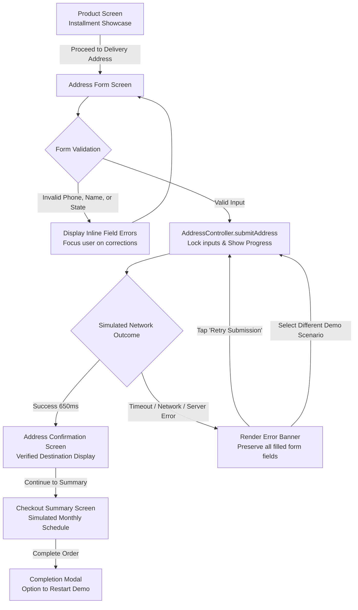

# CDcare Address Checkout Prototype (Flutter)

[](https://flutter.dev)
[](https://dart.dev)
[](https://riverpod.dev)
[](https://flutter.dev)
[](https://flutter.dev)
[](#license-status)

A production-grade Flutter checkout prototype demonstrating a fault-tolerant, resilient delivery address capture and recovery flow, inspired by an independent exploration of Nigerian installment e-commerce (Buy Now Pay Later).

---

## ⚠️ Independent Project Disclaimer

> **Important Notice:**
> 
> This repository is an **independent portfolio prototype and engineering case study**.
> 
> - **No Affiliation:** This project is not affiliated with, endorsed by, maintained by, or in any way officially connected to **CDcare Limited** or any of its subsidiaries.
> - **Simulated Environment:** This application operates entirely with a local, in-memory mock repository. It **does not connect** to CDcare's production APIs, backends, databases, or third-party payment gateways.
> - **Zero Real Transactions:** No real monetary payments are processed, no cards are charged, and no real physical orders or dispatches will take place.
> - **No Commercial Claims:** This project makes no claim of having altered or improved CDcare's live commercial metrics, conversion rates, or business outcomes. It serves strictly as a technical showcase of mobile resilience, defensive state modeling, and user experience design under volatile mobile network conditions.

---

## Table of Contents

- [The Problem Observed](#the-problem-observed)
- [The Proposed Solution](#the-proposed-solution)
- [Application Flow](#application-flow)
- [Interactive Demo Scenarios](#interactive-demo-scenarios)
- [Screenshots & Demo Video](#screenshots--demo-video)
- [Architecture & State Management](#architecture--state-management)
- [Project Directory Structure](#project-directory-structure)
- [Nigerian Localization & Form Validation](#nigerian-localization--form-validation)
- [Testing & Quality Assurance](#testing--quality-assurance)
- [Setup & Running the Project](#setup--running-the-project)
- [License Status](#license-status)

---

## The Problem Observed

During an independent exploration of the CDcare mobile purchasing journey, address capture was identified as a critical, high-friction stage in installment-based e-commerce:

1. **Vulnerability to Unstable Connections:** In volatile mobile network conditions (frequent packet drops, high latency, or cellular cell-tower switching), address submissions could hang indefinitely without a deterministic client-side timeout.
2. **Silent or Opaque Failures:** When an HTTP failure occurred, users were often met with generic failure alerts or uninformative states, leaving them uncertain whether the address was persisted or lost.
3. **Destructive Form Resetting:** A failed submission frequently cleared user inputs or forced navigation out of the flow, forcing customers to re-type long Nigerian street addresses and contact numbers.
4. **Double-Submission & Race Conditions:** Repeatedly tapping an unresponsive "Save" button could launch duplicate asynchronous mutations against the network layer.

In Buy Now Pay Later (BNPL) ecosystems, physical address collection is required for verification and doorstep delivery scheduling. Unrecoverable friction at this stage directly causes checkout abandonment.

---

## The Proposed Solution

This prototype implements a production-ready, fault-tolerant checkout journey designed specifically around defensive programming and mobile resilience:

- **Finite State Machine:** Address submission state transitions cleanly through `idle`, `submitting`, `failure`, and `success` via an immutable `AddressSubmissionState`.
- **Client-Side Concurrency Guard:** Submissions in progress immediately lock the form controls and ignore duplicate taps until the active asynchronous operation concludes.
- **Configurable Request Timeouts:** Requests are bounded by an explicit client timeout (default: 5 seconds). If the simulated service exceeds this window, the controller safely aborts client-side waiting and presents actionable recovery UI.
- **Preserved Form Inputs:** If a timeout or server error occurs, form data is never destroyed. All entered fields remain intact in memory and on the screen.
- **One-Tap Retry Mechanism:** A dedicated "Retry Submission" action resubmits the cached address payload without requiring form re-entry.
- **Distributed Systems Awareness:** The UI explicitly educates reviewers and users that a client-side timeout does not guarantee that the server never processed the payload, noting the architectural requirement for server-side idempotency tokens in real-world deployments.
- **Built-In Scenario Simulator:** A reviewer dropdown is embedded right into the address screen, allowing testing of 5 real-world network edge cases instantly without Charles Proxy, Postman, or backend stubs.

---

## Application Flow

The application models a four-stage step-by-step checkout lifecycle:



### Flow Breakdown

1. **Address Form Entry:** The user fills in the recipient's full name, Nigerian telephone number, State, Local Government Area (LGA) / City, and detailed street address.
2. **Client Validation:** Inputs are verified against Nigerian formatting rules (11-digit local numbers `080...` or international format `+234...`, mandatory state selection, minimum character thresholds).
3. **Simulated Request Execution:** Upon pressing "Save & Continue":
   - The primary button transitions to an inline loading spinner.
   - Interactive fields are disabled to prevent duplicate submissions.
   - `AddressController` forwards the immutable `DeliveryAddress` payload to `AddressRepository.saveDeliveryAddress()`.
4. **Outcome Evaluation:**
   - **On Success:** State transitions to `AddressSubmissionStatus.success`. The app automatically routes to `AddressConfirmationScreen` where the user reviews the delivery destination.
   - **On Error / Timeout:** State transitions to `AddressSubmissionStatus.failure`. The `SubmissionStatusView` surfaces an error container explaining the failure, leaving all text fields intact.
5. **Retry or Checkout Completion:**
   - **Retry:** Tapping "Retry Submission" re-issues the identical address model via `AddressController.retry()`.
   - **Checkout:** From the confirmation screen, the user proceeds to `CheckoutScreen` to review the simulated installment schedule (monthly payment breakdown) before finalizing the simulated order.

---

## Interactive Demo Scenarios

An embedded **Demo-Only Scenario Simulator** is positioned above the address form so reviewers can test error recovery without writing code:

| Scenario | Simulated Behavior | Verification Purpose |
| :--- | :--- | :--- |
| **1. Success** | Resolves after a realistic 650ms delay | Demonstrates happy-path validation, loading state, and screen progression. |
| **2. Client Timeout** | Delays beyond the 5-second client timeout threshold | Verifies that the app does not hang indefinitely and surfaces client timeout messaging. |
| **3. Network Failure** | Throws `NetworkAppException` | Simulates socket disconnection, airplane mode, or mobile DNS outage. |
| **4. Server Failure** | Throws `ServerAppException` (HTTP 500) | Simulates unexpected internal server or gateway errors. |
| **5. Fail Once, Then Succeed** | Fails with network error on attempt #1; succeeds on attempt #2 | Demonstrates single-tap resilience: user taps "Retry" and seamlessly completes checkout without retyping. |

---

## Screenshots & Demo Video

> *Visual assets captured from manual validation on an Android physical device.*

### Walkthrough Screenshots

| Product & Installment Showcase | Address Form & Validation |
| :---: | :---: |
| <!-- SCREENSHOT PLACEHOLDER: 01_product_screen.png (Product details and installment breakdown) --> <br> *Sample electronics product with 6-month installment plan* | <!-- SCREENSHOT PLACEHOLDER: 02_address_validation.png (Address form displaying validation errors) --> <br> *Nigerian phone number and address field validation* |

| Simulated Failure & Recovery | Confirmed Delivery Destination |
| :---: | :---: |
| <!-- SCREENSHOT PLACEHOLDER: 03_error_retry.png (Error banner with Retry button and form data preserved) --> <br> *Actionable error container with preserved form data and Retry action* | <!-- SCREENSHOT PLACEHOLDER: 04_address_confirmation.png (Address confirmation card with Edit option) --> <br> *Confirmed delivery destination review screen* |

| Simulated Checkout Summary | Demo Completion Modal |
| :---: | :---: |
| <!-- SCREENSHOT PLACEHOLDER: 05_checkout_summary.png (Installment breakdown schedule and verified address) --> <br> *Installment payment schedule & simulated order summary* | <!-- SCREENSHOT PLACEHOLDER: 06_completion_modal.png (Dialog showing prototype architectural highlights) --> <br> *End-of-flow summary and demo reset dialog* |

### Demo Recording

<!-- DEMO VIDEO PLACEHOLDER: demo_recording.mp4 (Screen recording showing happy path, error simulation, and retry recovery) -->
> *Placeholder: A short MP4/WebM video recording demonstrating end-to-end checkout, scenario switching, and retry recovery will be linked here.*

---

## Architecture & State Management

The project is structured according to **Feature-First Clean Architecture**, separating concerns cleanly between domain logic, data sources, and presentation:

```
lib/
├── core/
│   ├── errors/
│   │   └── app_exception.dart       # Sealed exception hierarchy (Network, Timeout, Server, Validation)
│   ├── theme/
│   │   └── app_theme.dart           # Accessible Material 3 design system (Navy/Blue/Slate)
│   └── widgets/
│       └── primary_button.dart      # Accessible action button with loading and icon states
├── features/
│   └── checkout/
│       ├── data/
│       │   └── mock_address_repository.dart  # Configurable in-memory repository with 5 scenarios
│       ├── domain/
│       │   ├── models/
│       │   │   ├── delivery_address.dart    # Immutable address model with copyWith and value equality
│       │   │   ├── product.dart             # Model type alias
│       │   │   └── products.dart            # Product and installment pricing model
│       │   └── repositories/
│       │       └── address_repository.dart  # Abstract contract for address persistence
│       └── presentation/
│           ├── controllers/
│           │   └── address_controller.dart  # Riverpod Notifier, timeout guard, retry, and state
│           ├── screens/
│           │   ├── address_confirmation_screen.dart # Step 2 review screen
│           │   ├── address_screen.dart              # Step 1 input & scenario simulator
│           │   ├── checkout_screen.dart             # Step 3 payment schedule & completion
│           │   └── product_screen.dart              # Initial catalog landing screen
│           └── widgets/
│               ├── address_form.dart        # Localized Nigerian address form & validators
│               ├── order_summary.dart       # Reusable product installment summary card
│               └── submission_status.dart   # Responsive loading, error, and timeout view
└── main.dart                                # Application bootstrap & ProviderScope
```

### State Management Highlights

- **Riverpod 3 Notifier Pattern:** `AddressController` extends `Notifier<AddressSubmissionState>`, avoiding legacy stateful boilerplate and enabling straightforward overrides in widget tests.
- **Immutable State Modeling:** `AddressSubmissionState` holds typed flags (`status`, `errorMessage`, `appException`, `savedAddress`, `lastAttemptedAddress`).
- **Defensive Concurrency:**
  ```dart
  Future<void> submitAddress(DeliveryAddress address) async {
    if (state.isSubmitting) return; // Prevent duplicate concurrent calls
    // ...
  }
  ```
- **Late Error Guarding:** Promises are wrapped with unawaited error handling so late-resolving network promises do not crash listeners after a client timeout has already fired:
  ```dart
  final repoFuture = repository.saveDeliveryAddress(address);
  unawaited(repoFuture.catchError((Object _) {}));
  await repoFuture.timeout(timeoutDuration, onTimeout: ...);
  ```

---

## Nigerian Localization & Form Validation

The address form is tailored to Nigerian e-commerce delivery logistics:

- **State Dropdown:** Pre-populated with all 36 Nigerian states plus the Federal Capital Territory (`Abuja (FCT)`).
- **Nigerian Phone Number Regex:** Validates standard 11-digit local formats (`080...`, `081...`, `070...`, `090...`, `091...`) and international E.164 formats (`+234...` / `234...`):
  ```dart
  RegExp(r'^(?:\+?234|0)[789][01]\d{8}$')
  ```
- **Local Government Area (LGA) & Town:** Validates administrative subdivisions required by Nigerian last-mile logistics dispatchers.

---

## Testing & Quality Assurance

The codebase includes **29 automated tests** covering unit, state controller, repository, and multi-step widget integration flows.

### Test Suite Summary

| Test Suite | File Path | Tests | Scope |
| :--- | :--- | :---: | :--- |
| **Validation Tests** | `test/features/checkout/domain/address_validation_test.dart` | 13 | Nigerian phone regex, recipient names, state, LGA, and street validation. |
| **Repository Tests** | `test/features/checkout/data/mock_address_repository_test.dart` | 6 | All 5 mock scenarios, simulated latencies, and in-memory CRUD operations. |
| **Controller Tests** | `test/features/checkout/presentation/address_controller_test.dart` | 8 | Concurrency deduplication, timeout triggers, failure state transitions, and retry recovery. |
| **Widget Integration** | `test/features/checkout/presentation/address_flow_widget_test.dart` | 4 | Complete form entry, button loading/disabling, error banner visibility, and multi-screen navigation. |
| **Smoke Test** | `test/widget_test.dart` | 1 | App root bootstrap and initial product screen render. |
| **Total** | | **29** | **100% Passing** |

### Code Quality Verification

- **Code Formatting:** `dart format lib test` verified clean.
- **Static Analysis:** `flutter analyze` reported `No issues found!`.
- **Unit & Widget Tests:** `flutter test` reported all 29 tests passed.

---

## Setup & Running the Project

### Prerequisites

Ensure you have the following installed on your system:
- **Flutter SDK** (Version 3.22.0 or higher recommended)
- **Dart SDK** (Version 3.4.0 or higher)
- Android Studio / Xcode / VS Code with Flutter extension
- A connected physical device, emulator, or simulator

### 1. Clone the Repository

```bash
git clone https://github.com/Muhammad-Bashir24/cdcare.git
cd cdcare
```

### 2. Install Dependencies

```bash
flutter pub get
```

### 3. Run Static Analysis & Verification

```bash
# Verify formatting
dart format --set-exit-if-changed lib test

# Verify static analysis lints
flutter analyze

# Run all 29 automated tests
flutter test
```

### 4. Launch the Application

```bash
# Run on an active Android device or emulator
flutter run

# Or run in release mode for performance profiling
flutter run --release
```

---

## License Status

*(Decision Pending)*

This repository currently does not include a license file. Recommended open-source licenses for portfolio demonstration projects include:
- **MIT License:** Permissive, allows others to view, study, and reuse code with attribution.
- **Apache 2.0:** Permissive with explicit patent rights grants.
- **CC BY-NC 4.0 / All Rights Reserved:** Protects original demonstration assets while permitting public review.

*The license decision will be confirmed prior to final repository release.*
